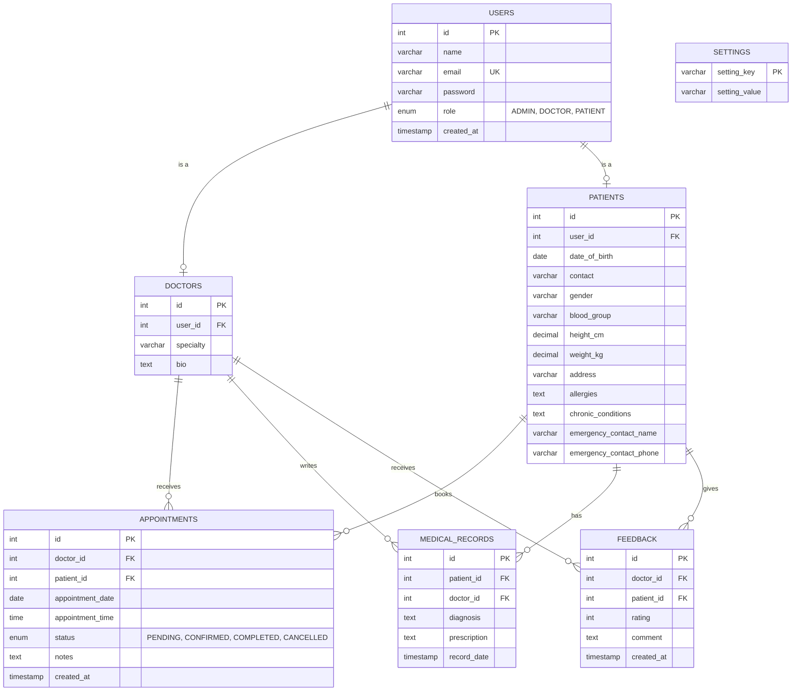

# Database Design

Database: `healthpulse_web` (MySQL)

## Design notes

- A user's role decides which profile table holds their extra details: `doctors` or `patients`. Admins have none.
- Deleting a user cascades to their doctor or patient record and everything linked to it.
- Age and BMI are calculated when read and are never stored, so they can't go stale.